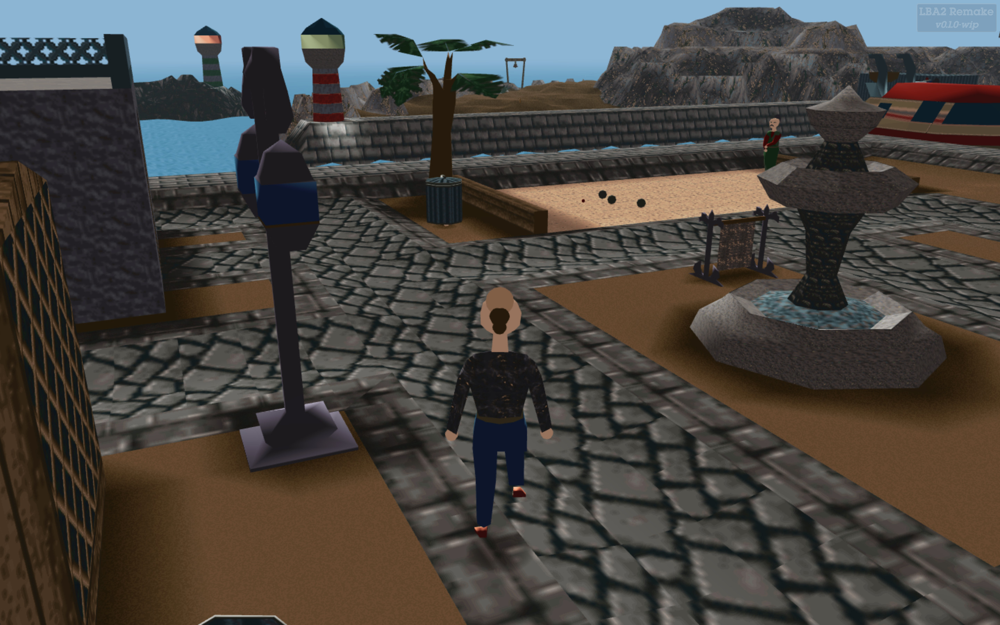
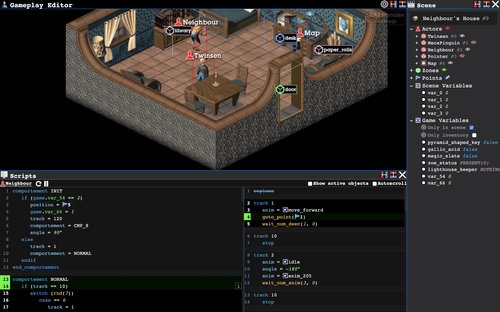

# LBA1 & LBA2 Remake

A Little Big Adventure 1 & 2 (*Twinsen's Adventure* / *Twinsen's Odyssey*) reimplementation in TypeScript, Three.js, and React.

## Vision / Goals

#### Phase 1: Reimplement the LBA1 and LBA2 game engine
* Should look and play like the original
* Full re-engineering instead of disassembly-based approach
* Focus on code quality, easy to read and modify

#### Phase 2: Make an HD version of the game
* Improve graphics and gameplay in a way that preserves the original look & feel
* More of a remastered version than a remake
* Support more platforms and ways of playing (e.g., VR & Mobile)

#### Phase 3: Platform for modding and action/adventure game development
* Progressively add tools to the editor to support mods
* Have all tools grouped in a single integrated platform

---

## Status

Currently you can walk around every island and buildings of the original game.
Most of the graphic elements are implemented and part of the gameplay.




The editor mode allows navigating around the game scenes, inspecting scene content and variables, inspecting game engine internal variables, and debugging scripts (including breakpoints on actor scripts).



For more information, check the [FAQ](doc/FAQ.md) and [Architecture Guide](doc/architecture.md).

---

## Getting Started

*(For full details, see [Getting Started](doc/getting_started.md))*

### Prerequisites
* [Node.js](https://nodejs.org) (v18+ LTS recommended)
* A copy of the original Little Big Adventure 2 game files (from GOG, Steam, or original CD).

### Quick Setup

1. **Clone the repository:**
   ```bash
   git clone https://github.com/utkarshbhai007/game.git
   cd game
   ```

2. **Install dependencies:**
   ```bash
   npm install
   ```

3. **Import original game assets:**
   * **Windows (PowerShell):**
     ```powershell
     npm run import:win "C:\Games\Little Big Adventure 2"
     ```
   * **macOS / Linux:**
     ```bash
     npm run import "/Applications/Little Big Adventure 2 (Twinsen's Odyssey).app/"
     ```

4. **Start the local dev server:**
   ```bash
   npm run dev
   ```

5. Open [http://localhost:8080](http://localhost:8080) in your web browser.

---

## License & Disclaimer

While the original Little Big Adventure game executables, assets, and intellectual property belong to Studio [2.21], the code within this reimplementation project is released under the [MIT License](package.json).
